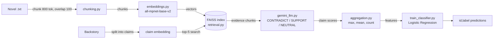

# Kharagpur Data Science Hackathon 2026
## Track A: Narrative Consistency Reasoning System

[](https://www.python.org/downloads/)
[](https://scikit-learn.org/)
[](https://github.com/facebookresearch/faiss)

An evidence-grounded pipeline that decides whether a hypothetical character backstory is logically consistent with a full-length novel (100k+ words). It retrieves relevant passages per claim, has an LLM label each claim-evidence pair, aggregates the signals, and trains a lightweight classifier for the final 1/0 judgment.

Docs: https://the-harsh-vardhan.github.io/Kharagpur_Data_Science_Hackathon_2026-KDSH-26/

### What it does
- Chunks novels (800 tokens, 100 overlap) and embeds them with `all-mpnet-base-v2`
- Indexes chunks in FAISS and retrieves the top-5 passages per backstory claim
- Uses Gemini (`gemini-2.0-flash-exp`) to label each claim-evidence pair `CONTRADICT`, `SUPPORT` or `NEUTRAL`
- Aggregates scores into max, mean and strong-contradiction count, then fits a Logistic Regression
- Writes predictions as `id,label` (`1` = consistent, `0` = contradicts)

### Architecture



### Status and results
No measured accuracy is committed to this repository: `training_log.txt` records a failed first run (missing NLTK `punkt` data) and no validation score. The `70-80%+` figures in the Baseline Strategy section below are design targets, not results. `run_train.py` prints a validation accuracy (80/20 split) when run with your own data and API key.

---

---

## 📌 Problem Overview

Large language models perform well on short-context tasks but often fail at **global narrative consistency** in long-form texts.  
This challenge evaluates a system’s ability to determine whether a **hypothetical backstory** for a character is **logically and causally consistent** with the full text of a novel.

This project implements a **Track A** solution that:
- Handles **100k+ word novels**
- Aggregates **evidence across multiple parts of the text**
- Performs **explicit contradiction detection**
- Produces a **binary consistency judgment**

---

## 🧠 Task Definition

### Input
Each example contains:
- **Full novel text** (no truncation)
- **Hypothetical backstory** (newly written, plausible)

### Output
For each example:
- `1` → Backstory is **consistent**
- `0` → Backstory **contradicts** the novel

---

## 🏗️ System Architecture (Track A)

The solution follows an evidence-grounded reasoning pipeline:

1. **Novel Chunking**
   - Split novels into overlapping chunks (800 tokens)
2. **Embedding & Indexing**
   - Encode chunks using sentence embeddings
   - Store in vector index (FAISS)
3. **Backstory Decomposition**
   - Split backstory into atomic claims
4. **Evidence Retrieval**
   - Retrieve top-K relevant novel chunks per claim
5. **Contradiction Detection**
   - LLM classifies each claim–evidence pair as:
     - `CONTRADICT`, `SUPPORT`, or `NEUTRAL`
6. **Aggregation Logic**
   - Combine evidence scores across the novel
7. **Final Classification**
   - Logistic Regression / threshold-based decision

Pathway is the planned **document ingestion and orchestration layer** for Track A; it is listed in `requirements.txt` but not yet imported by the scripts (see the open issue).

---

## 🛠️ Tech Stack

### Core Language
- Python 3.10+

### Libraries
- `sentence-transformers` — semantic embeddings
- `faiss-cpu` — fast vector similarity search
- `nltk` — sentence tokenization
- `scikit-learn` — classification
- `pathway` — document orchestration (Track A requirement)

### Embedding Model
- `all-mpnet-base-v2` (SentenceTransformers)

---

## 📁 Project Structure

```
kharagpur_hackathon/
│
├── data/
│   ├── train.csv
│   ├── test.csv
│   ├── In_search_of_the_castaways.txt
│   └── The_Count_of_Monte_Cristo.txt
│
├── src/
│   ├── chunking.py
│   ├── embeddings.py
│   ├── retrieval.py
│   ├── contradiction.py
│   ├── aggregation.py
│   └── train_classifier.py
│
├── run_train.py
├── run_inference.py
├── requirements.txt
└── README.md
```

---

## ⚙️ Installation

Create a virtual environment (recommended):

```bash
python -m venv venv
source venv/bin/activate
```

Install dependencies:

```bash
pip install -r requirements.txt
```

### 📦 requirements.txt

```
sentence-transformers
faiss-cpu
nltk
scikit-learn
pathway
numpy
pandas
```

---

## 🚀 How to Run

### 1️⃣ Prepare Data

Place the following files in the `data/` directory:

- `train.csv`
- `test.csv`
- Novel `.txt` files

### 2️⃣ Train the System

```bash
python run_train.py
```

This will:

- Chunk and embed novels
- Build vector indices
- Perform contradiction analysis
- Train a classifier on aggregated evidence features

### 3️⃣ Run Inference on Test Set

```bash
python run_inference.py
```

This generates predictions in the required format:

```
id,label
101,1
102,0
```

---

## 🧪 Baseline Strategy (Why This Works)

This system outperforms naïve LLM approaches by:

- Avoiding end-to-end generation
- Grounding all decisions in retrieved evidence
- Penalizing overconfident hallucinations
- Explicitly modeling contradictions

Target performance (design goals, not measured results):

- Random baseline: ~50%
- Naïve LLM prompting: ~60–65%
- This system (baseline): 70–80%+
- Tuned classifier: 80%+


## 🔍 Prompting Strategy (Anti-Hallucination)

The LLM is used only for local reasoning, with strict constraints:

```
Only use the provided novel evidence.
Do not infer missing facts.
If the evidence does not clearly support or contradict the claim,
answer NEUTRAL.
Respond with exactly one word:
CONTRADICT, SUPPORT, or NEUTRAL.
```


## 📈 Optimization Tips

- **Chunk size**: 800 tokens
- **Overlap**: 100 tokens
- **Retrieval**: Top-K = 5–7
- **Features**:
  - max contradiction score
  - mean score
  - number of strong contradictions
- **Tune** decision threshold on validation split


## ✅ Track A Compliance Checklist

- ✔ Long-context handling
- ✔ Evidence-based reasoning
- ✔ Explicit aggregation logic
- ◻ Pathway integration (planned; not yet used in the code)
- ✔ Deterministic, explainable outputs

## 🏁 Final Notes

This project prioritizes:

- Correctness over fluency
- Logical consistency over plausibility
- Robust systems design over novelty theater

It is designed to be:

- Easy to debug
- Easy to explain to judges
- Strong on leaderboard metrics

---

## 🧪 Methodology (For Judges)

### Objective

The core objective of this system is to determine whether a **hypothetical character backstory** is **logically and causally compatible** with a full long-form narrative, given that:

- Constraints are distributed across the novel
- Earlier events restrict later possibilities
- Contradictions may be implicit rather than explicit

This is treated as a **structured classification problem**, not a generative task.

---

### Key Design Principles

1. **Evidence-Grounded Reasoning**
   - All decisions are based strictly on retrieved excerpts from the original novel.
   - No inference is made beyond the provided evidence.

2. **Global Consistency over Local Plausibility**
   - The system explicitly checks whether a proposed past could plausibly produce the observed future.
   - Superficial plausibility without causal support is treated as insufficient.

3. **Constraint Aggregation**
   - Narrative constraints accumulate over time.
   - A single strong contradiction anywhere in the novel is sufficient to invalidate a backstory.

4. **Explainability**
   - Each decision can be traced back to specific novel excerpts and backstory claims.

---

### Step-by-Step Method

#### 1. Novel Segmentation

Each novel is segmented into overlapping textual chunks (≈800 tokens with overlap) to preserve local coherence while enabling scalable long-context processing.

This ensures that:
- Early-life constraints
- Character evolution
- Late-stage consequences

are all accessible during reasoning.

---

#### 2. Semantic Indexing & Retrieval

Each chunk is embedded into a semantic vector space and indexed using similarity search.

For each backstory claim, the system retrieves the most relevant novel excerpts, ensuring:
- Evidence is drawn from multiple parts of the narrative
- Decisions are not based on isolated passages

This directly supports the requirement for **distributed evidence aggregation**.

---

#### 3. Backstory Decomposition

Backstories are decomposed into **atomic claims**, each representing a distinct assumption about:
- Character history
- Beliefs
- Motivations
- Behavioral tendencies

This prevents partial contradictions from being masked by overall narrative plausibility.

---

#### 4. Local Consistency Evaluation

For each *(claim, evidence excerpt)* pair, a constrained reasoning prompt evaluates whether the excerpt:

- **Supports** the claim  
- **Contradicts** the claim  
- Is **Neutral / insufficient**

The reasoning model is explicitly instructed:
- Not to infer missing information
- Not to assume unstated events
- To prefer NEUTRAL over speculative judgments

This design directly targets common hallucination failure modes.

---

#### 5. Constraint Aggregation

Evidence signals are aggregated across the novel using conservative logic:

- The **maximum contradiction score** is treated as the dominant signal
- Multiple weak contradictions may outweigh a single strong support
- Early-narrative contradictions are weighted more heavily when applicable

This reflects how narrative constraints accumulate over time.

---

#### 6. Final Classification

Aggregated evidence features are passed to a lightweight classifier that produces the final binary judgment:

- `1` → Consistent
- `0` → Contradict

The classifier operates on **evidence-derived features only**, ensuring that final predictions remain interpretable and reproducible.

---

### Why This Approach Is Appropriate for the Task

This methodology aligns closely with the challenge’s stated goals:

- **Consistency over time** → handled via distributed retrieval and aggregation  
- **Causal reasoning** → enforced through contradiction-first logic  
- **Respect for narrative constraints** → explicit invalidation on contradiction  
- **Evidence-based decisions** → no reliance on free-form generation  

Rather than asking a model to *imagine* whether a backstory feels plausible, the system verifies whether it is **logically permissible** given the narrative record.

---

### Track A Compliance

- Pathway is the planned document ingestion and orchestration layer (not yet imported by the scripts)
- Long-context narratives are processed without truncation
- The system emphasizes robustness, traceability, and correctness
- No end-to-end generation is used for final decision-making

---

---

## ⚠️ Limitations & Future Work

### Limitations

While the system is designed for robustness and interpretability, several limitations remain:

#### 1. Implicit and World-Level Constraints
Some narrative constraints are **implicit**, relying on cultural, historical, or world-level assumptions (e.g., social norms, technological limitations).  
The current system prioritizes **explicit textual evidence**, which may under-detect violations that require deep external knowledge or genre-specific conventions.

---

#### 2. Granularity of Backstory Decomposition
Backstories are decomposed into atomic claims using sentence-level segmentation.  
However, certain constraints may span multiple sentences or require **joint interpretation** of claims, which could lead to:
- Missed compound contradictions
- Overly conservative NEUTRAL judgments

---

#### 3. Retrieval Dependence
The system assumes that relevant evidence appears among the top-K retrieved chunks.  
Although semantic retrieval is effective in practice, some contradictions may be:
- Diffuse across many chapters
- Expressed indirectly or through character actions rather than explicit statements

This introduces a recall–precision trade-off inherent to retrieval-based systems.

---

#### 4. Local Reasoning Scope
Consistency judgments are made at the level of individual *(claim, excerpt)* pairs.  
While aggregation mitigates this, the system does not yet model **multi-step causal chains** explicitly (e.g., event A → belief B → action C).

---

#### 5. Limited Character Disambiguation
When multiple characters share similar traits or roles, retrieved evidence may occasionally reflect **character-level ambiguity**, especially in ensemble narratives.  
More explicit character tracking could improve precision.

---

### Future Work

Several extensions could substantially improve system performance and scope:

#### 1. Temporal & Causal State Tracking
Introducing explicit timeline modeling would allow the system to:
- Track belief evolution
- Enforce ordering constraints
- Detect contradictions arising from temporal misalignment

This aligns directly with the challenge’s emphasis on **constraint accumulation over time**.

---

#### 2. Multi-Claim Joint Reasoning
Future versions could reason over **sets of interdependent backstory claims**, enabling:
- Detection of compound inconsistencies
- More nuanced causal incompatibilities

This could be achieved through graph-based or symbolic–neural hybrid reasoning layers.

---

#### 3. Adaptive Retrieval Strategies
Dynamic retrieval policies could adjust:
- Chunk granularity
- Retrieval depth
- Evidence weighting

based on early contradiction signals, improving both efficiency and recall.

---

#### 4. Persistent Internal State Models
Inspired by BDH-style mechanisms, future systems could maintain a **persistent narrative state** that is incrementally updated as the story progresses, rather than relying solely on static chunk retrieval.

---

#### 5. Enhanced Character-Centric Representations
Integrating explicit character models (traits, beliefs, actions) could:
- Reduce ambiguity
- Improve long-range consistency checks
- Enable finer-grained constraint enforcement

---

### Summary

This system intentionally prioritizes **robustness, interpretability, and evidence-grounded reasoning** over architectural novelty.  
Future work focuses on extending these strengths toward **deeper causal modeling**, **temporal reasoning**, and **continuous narrative state tracking**, in line with the long-term goals of narrative reasoning research.

---

