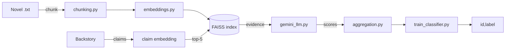

# Architecture

| Module | Role |
|---|---|
| `src/chunking.py` | Overlapping chunks, default 800 tokens and 100 overlap |
| `src/embeddings.py` | `all-mpnet-base-v2` sentence embeddings, batch size 32 |
| `src/retrieval.py` | FAISS `VectorStore` with `search(query, k=5)` |
| `src/contradiction.py` | Prompt and mapping of the LLM label to a score (CONTRADICT 1.0, NEUTRAL 0.3, SUPPORT 0.0) |
| `src/gemini_llm.py` | Rate-limited, retrying batch calls to Gemini |
| `src/aggregation.py` | Max, mean and count of scores above 0.7 |
| `src/train_classifier.py` | Logistic Regression with an 80/20 validation split |

Entry points: `run_train.py` builds indices, scores claims and saves `models/classifier.pkl`; `run_inference.py` writes the `id,label` predictions.

Setup: see `SETUP.md` in the repository. The Gemini API key is read from the environment (`GEMINI_API_KEY`, template in `.env.example`).
